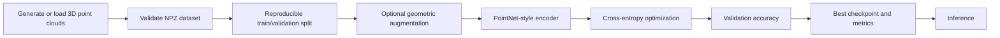

# AI 3D Model Training Pipeline

A reproducible **3D point-cloud deep learning starter repository** using Python and PyTorch. It demonstrates synthetic data generation, data validation, optional augmentation, PointNet-style feature extraction, model training, evaluation, checkpointing and inference.

> **Scope:** This is an educational 3D geometric-shape classification baseline, **not** a validated human-body weight, fat-percentage, clinical, radar, or RGB-D estimation system. No real scans, experimental outcomes or proprietary training data are included.

## Pipeline



## Quick start

Requires **Python 3.10+**. PyTorch installation depends on your CPU/CUDA configuration; see [PyTorch installation](https://pytorch.org/get-started/locally/).

```bash
python -m venv .venv
# Windows: .venv\Scripts\activate
# Linux/macOS: source .venv/bin/activate
pip install -r requirements.txt
python src/dataset.py --output data/synthetic_shapes.npz
python src/train.py --data data/synthetic_shapes.npz --epochs 15
python src/predict.py --checkpoint runs/pointnet/best_model.pt --data data/synthetic_shapes.npz --index 0
pytest -q
```

## Dataset specification

The `.npz` file must contain:

| Key | Shape | Type | Meaning |
| --- | --- | --- | --- |
| `points` | `(N, P, 3)` | `float32` | N point clouds, P XYZ points per cloud |
| `labels` | `(N,)` | `int64` | Class indices from 0 to C-1 |

The sample generator produces 360 labeled point clouds (120 each of spheres, cubes and cylinders) with 256 XYZ points per sample by default. All data are **synthetic**. Model outputs are shape classes, not body measurements.

## Training details

- **Input:** unordered XYZ points (`[batch, points, 3]`)
- **Encoder:** shared 1D convolutions (3 → 64 → 128 → 256), batch normalization and ReLU
- **Aggregation:** symmetric max pooling over points
- **Head:** dense layers and dropout
- **Loss:** cross-entropy; **optimizer:** Adam (`lr=0.001`)
- **Split:** seeded random 80% training / 20% validation
- **Metric:** validation accuracy, recorded at `runs/pointnet/metrics.json`
- **Checkpoint:** best model saved at `runs/pointnet/best_model.pt`
- **Device:** CUDA when available, otherwise CPU

The dataset loader supports optional random Z-axis rotation and Gaussian jitter. The default training loop does not turn on augmentation, to provide a simple deterministic baseline.

## Repository layout

```text
ai-3d-training-pipeline/
├── README.md
├── requirements.txt
├── .gitignore
├── LICENSE
├── src/
│   ├── dataset.py        # NPZ loader and synthetic 3D sample generator
│   ├── model.py          # PointNet-style neural network
│   ├── train.py          # Train, validate and checkpoint
│   └── predict.py        # Run checkpoint inference
├── tests/
│   └── test_pipeline.py  # Dataset and model sanity tests
└── data/
    └── .gitkeep
```

## Extending to real 3D reconstruction research

Real 3D or RGB-D reconstruction requires additional data acquisition, camera calibration, coordinate-frame alignment, segmentation, point-cloud filtering, geometry reconstruction and subject-aware evaluation. **These components are not implemented** in this shape-classification starter.

For regression tasks involving physical quantities, obtain appropriately consented real training data and ground-truth labels, then evaluate on independent data with suitable metrics such as MAE, RMSE and uncertainty. Do not infer clinical accuracy from this demonstration.

## Reproducibility and privacy

Keep raw sensor scans, private data and trained model weights outside the public repository unless publication rights and consent are verified. The `.gitignore` excludes datasets and experiment artifacts by default. No patent-specific sensor fusion algorithms, formulas or unpublished study results are included.

## License

MIT; see [LICENSE](LICENSE).
